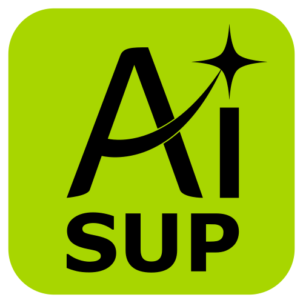
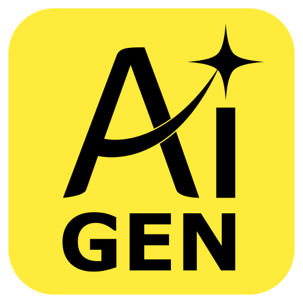
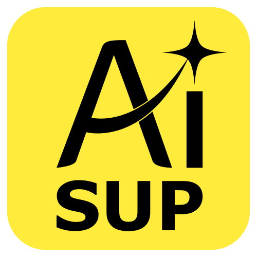
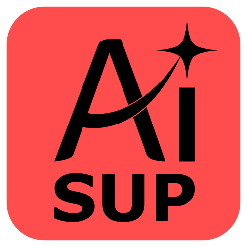
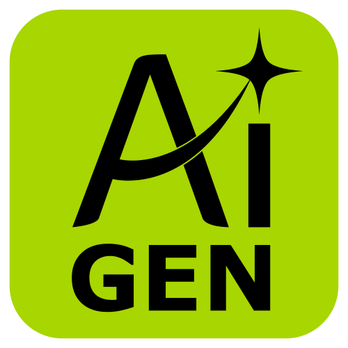
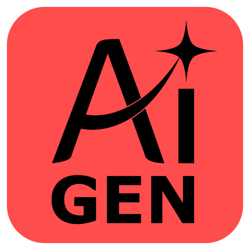

<h1>AI TRANSPARENCY ACT</h1>
Standardized, open-source svg and shield badges to declare the level of AI involvement in software, writing, design, and hardware projects.
  

  <a href="#-about-this-project"><b>About</b></a> •
  <a href="#-note-on-voluntary-adoption"><b>Disclosure</b></a> •
  <a href="#-why"><b>Why?</b></a> •
  <a href="#-label-structure-&-taxonomy"><b>Taxonomy</b></a> •
  <a href="#-how-to-use"><b>How to use?</b></a> •
  <a href="#-contributing-&-feedback"><b>Contributing & Feedback</b></a> •
  <a href="#-license"><b>License</b></a>

<h3><b> So we will start with it! </b></h3>

___
___

<h2> Documentation Disclosure </h2>

In line with the transparency principles of this project, please note that this `README.md` file was generated using 
**Gemini (Google AI)** to draft the taxonomy, structure, and usage guidelines. All content has been manually reviewed and verified by the maintainer.

ㅤ

<a href="#top">⬆️ Back to Top</a>

___
___

<h1>About</h1>
Standardized, open-source svg and shield badges to declare the level of AI involvement in software, writing, design, and hardware projects.

ㅤ

<a href="#top">⬆️ Back to Top</a>

___
___

<table width="100%" style="border-collapse: collapse;">
  <tr>
    <td style="background: #fffde7; border-left: 6px solid #ffeb3b; padding: 16px; border-radius: 4px;">
      

        <b>📌 Note on Voluntary Adoption:</b> 
        <i>Using these labels is completely voluntary. No maintainer or developer is obligated to adoption. However, if we want to build genuine trust, transparency, and acceptance around AI tools, clear disclosure is an impactful step forward. Sharing how a project was built helps foster understanding and mutual respect across the entire community.</i>
      

    </td>
  </tr>
</table>
ㅤ

<a href="#top">⬆️ Back to Top</a>

___
___

<h2>Why This Project Exists</h2>

As AI tools become deeply integrated into software development and content creation, transparency matters more than ever. Users, contributors, and maintainers have different expectations regarding code provenance, security, and human oversight. 

This repository provides a simple, standard labeling system so developers and creators can clearly state **how much AI was used** and **in what capacity**. Building up trust, respecting user preferences, and setting clear expectations.

ㅤ

<a href="#top">⬆️ Back to Top</a>

___
___

<h2>Label Structure & Taxonomy</h2>

The framework uses two primary categories split into three levels of intensity:

<b><h3>AI Assisted/Supported</h3></b>

 

<table>
  <thead>
    <tr>
      <th>Label</th>
      <th>Level</th>
      <th>Scope</th>
      <th>Human Oversight</th>
      <th>Typical Use Case</th>
    </tr>
  </thead>
  <tbody>
    <tr>
      <td align="center">
         
      </td>
      <td><b>🟢 Low</b></td>
      <td>Inline code completion (Copilot/Ghostwriter), basic syntax lookups, formatting, or simple bug fixes.</td>
      <td><b>90%+</b> written directly by humans.</td>
      <td>Everyday software development with IDE autocompletion enabled.</td>
    </tr>
    <tr>
      <td align="center">
         
      </td>
      <td><b>🟡 Mid</b></td>
      <td>Writing specific helper functions, generating documentation/comments, writing unit tests, or refactoring existing modules.</td>
      <td>Human designs overall structure and logic; AI writes discrete blocks under supervision.</td>
      <td>A developer prompts an AI to generate a specific regex or parsing module, then integrates it manually.</td>
    </tr>
    <tr>
      <td align="center">
         
      </td>
      <td><b>🔴 High</b></td>
      <td>Co-architecting entire files, writing core algorithms based on user prompts, heavy debugging, and generating setup scripts.</td>
      <td>Human acts as product manager and integrator; code is thoroughly reviewed and edited before commit.</td>
      <td>Complex feature implementations built via conversational AI sessions with active human iteration.</td>
    </tr>
  </tbody>
</table>

<b><h3>AI Generated</h3></b>

 

<table>
  <thead>
    <tr>
      <th>Label</th>
      <th>Level</th>
      <th>Scope</th>
      <th>Human Oversight</th>
      <th>Typical Use Case</th>
    </tr>
  </thead>
  <tbody>
    <tr>
      <td align="center">
         
      </td>
      <td><b>🟢 Low</b></td>
      <td>Full code blocks or entire files generated by AI, but comprehensively audited, refactored, and tested by a human.</td>
      <td>Significant human validation, security checks, and manual fine-tuning.</td>
      <td>A project skeleton or module built by AI where the human verified every line for production readiness.</td>
    </tr>
    <tr>
      <td align="center">
         
      </td>
      <td><b>🟡 Mid</b></td>
      <td>Code or content generated via AI prompts with basic functionality testing and minor manual tweaks.</td>
      <td>High-level review and sanity checking; minimal structural edits.</td>
      <td>Utility scripts, quick CLI tools, or boilerplate generators used largely as outputted by the model.</td>
    </tr>
    <tr>
      <td align="center">
         
      </td>
      <td><b>🔴 High</b></td>
      <td>End-to-end AI generation (e.g., prompt-to-app, v0, AutoGPT) pushed with little to no modification or manual audit.</td>
      <td>Minimal to none beyond running the generation prompt.</td>
      <td>Experimental code, quick prototypes, or automated repository generation.</td>
    </tr>
  </tbody>
</table>

ㅤ

<a href="#top">⬆️ Back to Top</a>

___
___

<h2> How to Use in Your Project</h2>

<h3>Markdown Snippets</h3>

Copy and paste the relevant Markdown badge or svg into your repository’s `README.md`.

<table>
  <tr>
    <td align="center">
       
      <b>SUP — Low</b>
    </td>
    <td align="center">
       
      <b>SUP — Mid</b>
    </td>
    <td align="center">
       
      <b>SUP — High</b>
    </td>
  </tr>
  <tr>
    <td align="center">
       
      <b>GEN — Low</b>
    </td>
    <td align="center">
       
      <b>GEN — Mid</b>
    </td>
    <td align="center">
       
      <b>GEN — High</b>
    </td>
  </tr>
</table>

<h3>SVG Labels</h3>

Right click copy image and past into your repository's `Readme.md`.

<table>
  <tr>
    <td align="center">
       
      <b>AI Assisted: Low</b>
    </td>
    <td align="center">
       
      <b>AI Assisted: Mid</b>
    </td>
    <td align="center">
       
      <b>AI Assisted: High</b>
    </td>
  </tr>
  <tr>
    <td align="center">
       
      <b>AI Generated: Low</b>
    </td>
    <td align="center">
       
      <b>AI Generated: Mid</b>
    </td>
    <td align="center">
       
      <b>AI Generated: High</b>
    </td>
  </tr>
</table>

ㅤ

<a href="#top">⬆️ Back to Top</a>

___
___

<h2> Contributing & Feedback </h2>

Suggestions for refining these definitions or adding asset icons are welcome. Please open an issue or submit a pull request!

ㅤ

<a href="#top">⬆️ Back to Top</a>

___
___

<h2> License </h2>

This specification and all associated badges are available under the **CC0 1.0 Universal (Public Domain)** license. Feel free to use them freely in any open-source or commercial project.

ㅤ

<a href="#top">⬆️ Back to Top</a>
